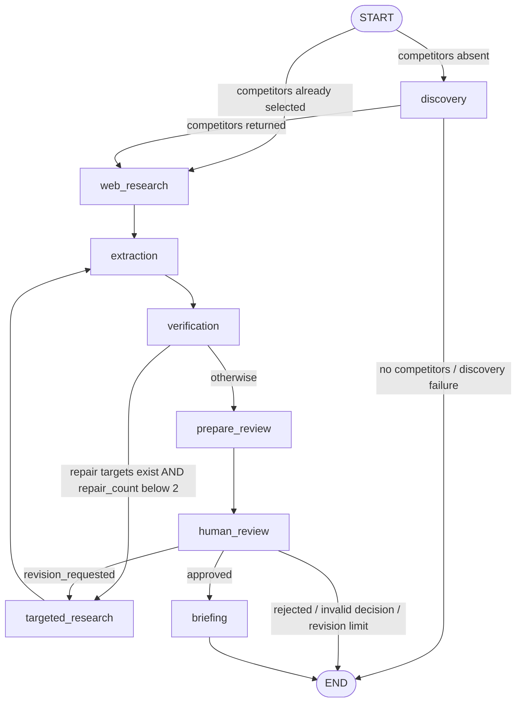
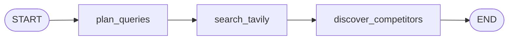
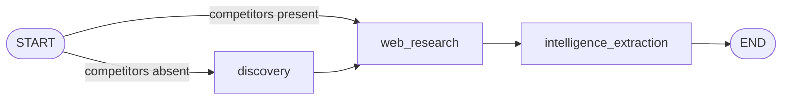

# Implemented architecture

This diagram describes the actual `build_full_graph()` in
[`src/full_workflow.py`](../src/full_workflow.py), inspected during submission
preparation. It has nine application nodes and fourteen edges, including the
conditional start/end edges. It does not depict a proposed supervisor, report
synthesis LLM, or extra verification loop that is absent from the code.

## Complete persistent workflow

`human_review` calls LangGraph `interrupt()` inside the node. The diagram's outgoing
review edges apply only after the node is resumed with a decision; pausing is not
an additional edge. The actual routing functions return node names or `END`.

| Node | Implemented action | State/results |
|---|---|---|
| `discovery` | Invokes the existing discovery runner; catches terminal discovery failure | `competitors`, `errors`, or `workflow_error` and failed status |
| `web_research` | Reuses Phase 2 collection; handles per-competitor and initialization failures | `research`, `research_errors` |
| `extraction` | Fireworks/Pydantic profiles; retains prior verified claims during repair | `profiles`, extraction errors and gaps |
| `verification` | Checks quotes, URLs, exact values, context, source origin and known price conflicts | `verification`, `verified_facts`, `gaps`, `repair_targets`, retry count |
| `targeted_research` | Searches requested gap categories; retains successful ledgers and source versions | Updated evidence, `selected_names`, repair/retry counts |
| `prepare_review` | Sets pending status and a new review token | `approval_status`, `review_token` |
| `human_review` | Interrupts, validates resumed decision/token, records review history | Approved/rejected/revision status, feedback and revision count |
| `briefing` | Deterministically formats approved evidence only | `final_report`, formatter version, source fingerprint |

### Conditional predicates

1. `START`: truthy `competitors` routes directly to `web_research`; otherwise `discovery`.
2. After discovery: truthy `competitors` routes to research; otherwise `END`.
3. After verification: nonempty `repair_targets` and `repair_count < 2` routes to
   targeted research; otherwise `prepare_review` even if gaps remain.
4. After resumed human review: `approved` routes to briefing;
   `revision_requested` routes to targeted research; other statuses end.

Automatic repair count is capped at two. The review node separately permits two
human revisions. Revision research does not reset automatic repair count. When
`revision_count >= 2`, another revision request produces `revision_limit_reached`
and ends without a report. Missing evidence is disclosed rather than turned into fact.

## Existing phase-specific graphs

Discovery-only graph, [`src/discovery_agent.py`](../src/discovery_agent.py):

Phase 2 graph, [`src/graph.py`](../src/graph.py):

The full graph reuses the Phase 2 research/extraction implementations. These debug
graphs are intentionally separate: their buttons do not create a complete persistent
approval/report run, and they are not additional branches in the full graph diagram.

## Data and tool boundaries

- **Fireworks:** query planning, source-backed competitor selection, optional
  follow-up search planning and structured intelligence extraction. The same configured
  JSON-mode model wrapper validates Pydantic output and bounds retries.
- **Tavily Search:** discovery and competitor evidence categories. Research searches
  restrict vendor domains except news, which can use third-party publications.
- **Tavily Extract:** a batch of returned official page URLs; failure retains snippets.
- **Deterministic Python:** factual matching, conflict rules, routing counters,
  authorization and report formatting. No LLM call is made during report regeneration.
- **Streamlit:** explicit start/load/continue/review/regenerate actions. Ordinary
  reruns load snapshots without invoking tools.

Research records contain URL, title, content snippet, category, retrieval timestamp,
official-domain flag and optional publication date. Source history retains prior
full-page evidence when a later search returns a shorter snippet at the same URL.

The verifier distinguishes verified, unsupported, conflicting, missing and inferred
claims. Official hostname checks establish origin under the discovered website,
not legal ownership or independent accuracy. Excerpts and citations cannot prove
all claims semantically; human review remains part of the design.

## Persistent state and recovery boundary

[`ResearchState`](../src/discovery_agent.py) is the shared typed state. Full-workflow
persistence converts Pydantic objects to JSON-compatible values at checkpoint
boundaries. `SqliteSaver` stores state under a stable run UUID/thread ID in the local
ignored `.marketintel/checkpoints.sqlite` database. API keys and provider clients
are initialized outside graph state.

[`src/persistence.py`](../src/persistence.py) provides:

| Operation | Behavior |
|---|---|
| `start_run` | Whitelists inputs; existing thread returns saved state instead of restarting |
| `load_run` | Reads a snapshot; does not invoke nodes |
| `continue_run` | Explicitly invokes pending non-interrupted execution with the same thread |
| `review_run` | Checks pending status, active interrupt and review token; resumes with `Command` |
| `regenerate_briefing` | Requires completed approval; formats saved evidence and updates only terminal report state |

SQLite stores completed node state and interrupt data. Source search ledgers help
avoid repeating successful work during repairs. A process crash inside an unfinished
node can still repeat that node's tool calls; no exactly-once external transaction
is claimed. An OS-released per-run file lock guards concurrent mutations and stale
review tokens prevent duplicate approval.

## Report regeneration is not a research edge

Regeneration is an explicit persistence/UI operation outside graph execution. It
does **not** call `graph.invoke()` or `Command(resume=...)`; it uses
`graph.update_state(..., as_node='briefing')` on an already completed approved run.
It preserves `original_report`, archives prior versions in `report_history`, and
uses formatter metadata/content fingerprints for idempotency. There is therefore
no invented `briefing → discovery` or `briefing → human_review` edge in the diagram.

## Failure containment

Transient provider calls use bounded retry/backoff; authentication and invalid
configuration errors are not retried. Research budgets constrain searches and
extract retries. Failed competitors retain partial evidence while other competitors
continue. Exhausted verification repairs proceed to human review with warnings.
Discovery failure instead ends safely without fabricating competitors or an approval.
See [README](../README.md#error-recovery-and-runtime-limits) for concrete call/time limits.
