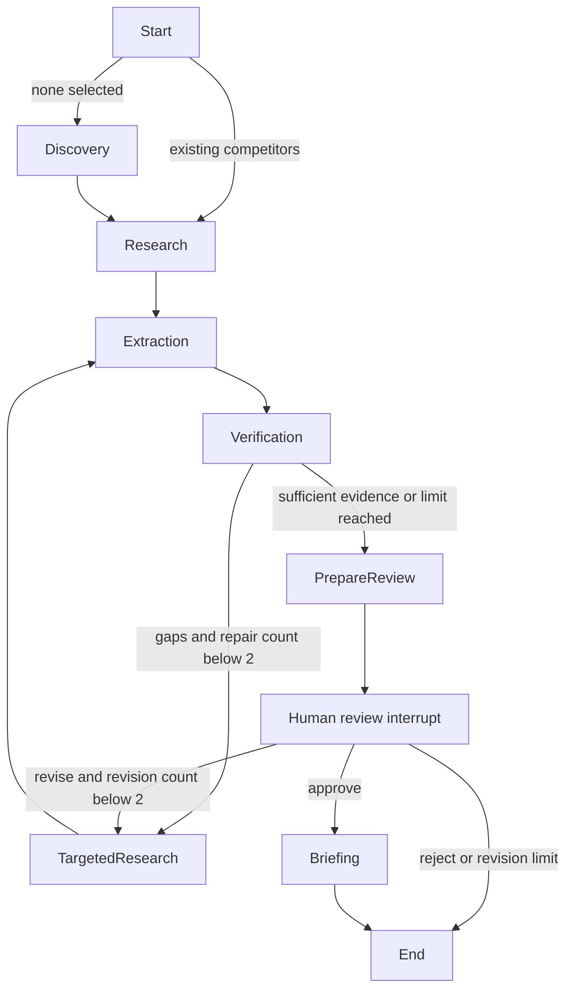

# Full research workflow

This extends the existing discovery and profile-debug actions. It uses the same
Fireworks JSON mode, configured model ID, Tavily integrations and `.venv`.
There are no paid API calls until you explicitly start, continue, or revise a run.
Loading a saved run, reviewing, approving and downloading do not call providers.

## Run with Notion

```powershell
.\.venv\Scripts\python.exe -m pip install -r requirements.txt
.\.venv\Scripts\python.exe -m streamlit run app.py --server.port 8501
```

Use a normal terminal with network permission. Keep `TAVILY_API_KEY`,
`FIREWORKS_API_KEY` and `FIREWORKS_MODEL` in the ignored `.env` file. No environment
or model replacement is needed. Stop an existing server with Ctrl+C before restarting.

1. Enter Notion and Productivity software. Click **Run Full Research**. Matching
   discovery results already in the session are reused; otherwise discovery runs.
2. Watch progress. The graph researches, extracts and verifies each competitor.
   Up to two automatic targeted repair cycles fill evidence gaps. Valid evidence
   is retained, and only gap categories are searched during repair.
3. Review the verification summary, source links, conflicts and missing evidence.
4. Choose **Approve**, **Request Revision** (with optional instructions), or **Reject**.
   Revision requests are limited to two, each allowing one additional targeted
   research pass. Exhausting that limit ends without an approved report.
5. Approval formats a briefing from verified factual excerpts and explicitly
   labeled interpretations. Download it with **Download Markdown Briefing**.
   Approving incomplete evidence never converts missing facts into verified ones.

## State and recovery

Saved run IDs are specific to the current database and deployment environment.
A run created locally is not automatically available in Streamlit Community Cloud;
the local database is excluded from Git and is not deployed with the source code.
If a run is missing, confirm the ID and return to the environment that created it,
or enter a company/industry and explicitly select **Run Full Research** to create
a new run. Loading a missing ID never starts research automatically.

The implemented SQLite path is project-relative `.marketintel/checkpoints.sqlite`
(see `DEFAULT_DB` in `src/persistence.py`). This is local application storage, not
an external database. **Streamlit Community Cloud's local filesystem is not durable
across restarts, redeployments, or container replacement.** The current code checks
storage availability when opening it and displays a friendly error, but the actual
deployed container's writability has not been independently inspected from here.
For production, use external persistent storage and a compatible durable LangGraph
checkpointer (for example, managed PostgreSQL). That migration is a future deployment
change, not something implemented or guaranteed by this UI-message update.

The official `langgraph-checkpoint-sqlite` saver persists checkpoints in
`.marketintel/checkpoints.sqlite`. This directory is ignored by git. Keep it when
restarting or moving the local application. The database contains research content,
competitor selections, verification findings, counts, review history and reports;
provider clients and API configuration are never passed into graph state.

Each run has a UUID used as LangGraph's `thread_id`. Its ID is displayed in the UI
and stored in the URL's `run` parameter. Retain that URL, or enter the ID under
**Saved research run ID** and click **Load Saved Run** after restarting. Loading
only reads state. If execution stopped between nodes, **Continue Saved Run** resumes
the pending node. Pending human review instead requires an explicit review action.

Review uses `interrupt()` and `Command(resume=...)` with the same thread ID.
Review tokens prevent stale or duplicate approval. An OS-released per-run file lock
prevents concurrent start/resume operations, including across processes. Refreshing
the UI never calls search tools or repeats approval. Checkpoints commit at node
boundaries: a process crash during an unfinished node can repeat that node's work
on explicit continuation. This is not an exactly-once external-tool transaction.

## Graph



## Evidence rules and limits

Verification does not rely on URL matches alone. Quotes must occur in retrieved
source text and claim values must match those quotes with numeric-aware boundaries.
`$10` does not match `$10.99` or `$100`. Pricing displays the full retrieved sentence
to preserve currency, plan, per-user terms and billing period. Optional structured
plan/currency/period fields must also occur in source context. Like-for-like official
pricing disagreements are marked conflicting rather than selected arbitrarily.
Official evidence is identified by the discovered vendor hostname/subdomains;
that is not independent proof of website ownership. Third-party findings are labeled.

Inferences are never facts. Inferred pricing, capabilities and news are rejected;
strategic interpretations are allowed for customers/positioning with supporting
evidence. Missing news dates remain Not verified. The verifier uses conservative
textual rules, not exhaustive semantic reasoning or independent fact checking.
Complex pricing tables and ambiguous plan/billing layouts still require human
review; conflict detection cannot prove the absence of all contradictions.

Each competitor pass permits at most five search attempts, including retries, and
one extract batch of at most four URLs (one transient retry allowed). Successful
queries and extracted URLs are retained in the research ledger. Source excerpts
are versioned when repair searches return new content at the same URL, preserving
prior full-page evidence and allowing price disagreements to remain visible. Repair searches
only requested categories. Discovery searches have at most two transient retries.
Research searches/extract have at most one transient retry with 0.5-second backoff;
discovery uses 0.5/1-second backoff. Authentication/configuration failures are not
retried. Fireworks retains its three-call total cap. Two automatic repairs plus
two human revisions keep the overall workflow bounded.

## Offline verification

```powershell
.\.venv\Scripts\python.exe -m compileall -q app.py src tests
.\.venv\Scripts\python.exe -m unittest discover -s tests -v
```

Tests use mocked providers and temporary SQLite databases. They cover numeric
precision, conflicting sources, unsupported citations, missing news, transient
errors and exhaustion, retained searches, SQLite reopening (including a fresh
Python process), interrupt/resume, stale reviews, revision limits, approval,
rejection and report filtering. No live paid API calls were made during development.
